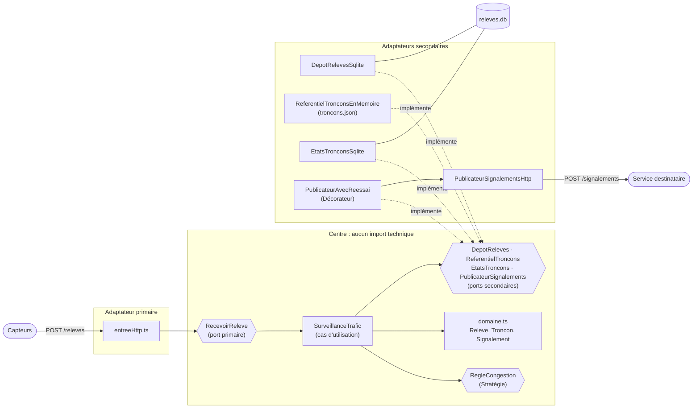
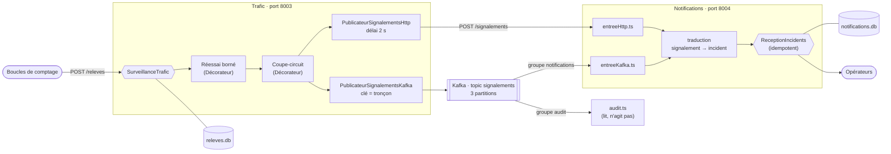

# UrbanHub : cours d'architecture hexagonale

Services **Qualité de l'air** (`urbanhub-air/`) et **Alertes** (`urbanhub-alertes/`), en TypeScript,
exécutés par Node.js (version 22.18 ou plus).

```bash
npm test          # toute la suite de tests
npm run air       # service Qualité de l'air, port 8001
npm run alertes   # service Alertes, port 8002
npm run trafic    # service Trafic, port 8003
npm run notifications       # service Notifications, port 8004 (TP 4)
npm run test:trafic         # les tests du seul service Trafic
npm run test:notifications  # les tests du seul service Notifications
docker compose -f compose.tp4.yaml up -d --build   # Trafic, Notifications et Kafka (TP 4)
```

## Service Trafic (TP 2)

Dossier : `urbanhub-trafic/`, en TypeScript, comme les deux autres services.

**Règle de gestion :** un tronçon de route est déclaré **congestionné** quand la vitesse moyenne
relevée par ses capteurs sur les 15 dernières minutes tombe sous 40 % de sa vitesse limite ;
UrbanHub signale alors la congestion une seule fois, jusqu'à ce que le tronçon redevienne fluide.

Le détail du choix est dans [`docs/tp2-etape1-choix-du-service.md`](docs/tp2-etape1-choix-du-service.md).

### Schéma



- **Les flèches pleines vont vers le centre :** l'entrée appelle le port primaire, et le service ne
  connaît que des ports.
- **Les flèches pointillées** sont les adaptateurs qui implémentent ces ports. Ils dépendent du
  centre, jamais l'inverse.
- **La racine de composition** [`principal.ts`](urbanhub-trafic/src/principal.ts) est le seul
  fichier qui crée et branche ces objets.
- **La règle de dépendance** est vérifiée par
  [`test/regleDependanceTrafic.test.ts`](test/regleDependanceTrafic.test.ts).

### Les deux patrons

#### Stratégie : la règle de congestion ([`regles.ts`](urbanhub-trafic/src/regles.ts))

| | |
|---|---|
| **Le problème** | La règle « moyenne sous 40 % de la limite » se trompe **la nuit**. Un seul bus à l'arrêt (5 km/h à 03:00) déclenche un faux bouchon. Et pendant un bouchon, un véhicule rapide isolé fait croire le tronçon fluide, puis le **même** bouchon est signalé une 2e fois (mesuré : 08:00 et 08:32). Le choix de la règle est une décision métier qui changera : par ville, par tronçon, selon l'heure. |
| **La solution** | Une interface `RegleCongestion` et deux règles interchangeables : `SeuilRelatif` (la règle ci-dessus) et `SeuilRelatifAvecMinimum` (pas de conclusion avec moins de 3 relevés). Le cas d'utilisation reçoit l'une ou l'autre sans savoir laquelle ; on choisit dans `principal.ts` (`REGLE=avec-minimum`). |
| **Maintenabilité (modifier)** | ✅ **Forte.** Une nouvelle règle (heures de pointe, voies rapides) est une **nouvelle classe** ; `service.ts` ne change pas. Chaque règle se teste seule. Le domaine ne garde que le vocabulaire. |
| **Scalabilité (tenir la charge)** | ➖ **Faible, mais réelle.** Le calcul est le même. La règle avec minimum évite les faux signalements, donc du travail inutile chez le destinataire et chez les opérateurs. |
| **Ce qu'il coûte** | Un fichier et une interface de plus (35 lignes) ; un 5e paramètre au constructeur du service ; un cas « pas de conclusion » (`undefined`) que le service doit comprendre ; un réglage (`REGLE`) à documenter, sans quoi personne ne sait quelle règle tourne en production. |
| **Preuve** | [`test/patronsTrafic.test.ts`](test/patronsTrafic.test.ts) : le faux bouchon avec la règle simple, puis 0 faux bouchon et 1 seul signalement avec le minimum. |

#### Décorateur : le réessai autour du publicateur ([`reessai.ts`](urbanhub-trafic/src/adaptateurs/reessai.ts))

| | |
|---|---|
| **Le problème** | Le signalement part par le réseau. Sans réessai, une panne passagère n'est rattrapée qu'**au relevé suivant**, qui peut arriver des minutes plus tard, ou jamais la nuit, si plus aucun véhicule ne passe. Écrire le réessai **dans** le publicateur HTTP l'aurait lié à HTTP (à refaire pour Kafka) ; l'écrire **dans** le service aurait mêlé une technique à la règle métier. |
| **La solution** | `PublicateurAvecReessai` implémente le **même port** `PublicateurSignalements` et enveloppe le publicateur réel : 3 essais, des pauses grandissantes (500 ms puis 1000 ms), et une panne durable **remonte** au lieu d'être avalée. Il s'assemble dans `principal.ts` : `new PublicateurAvecReessai(new PublicateurSignalementsHttp(url))`. |
| **Maintenabilité (modifier)** | ✅ **Forte.** Écrit une fois, il s'applique à tout publicateur (HTTP aujourd'hui, Kafka demain). Ni `service.ts` ni `publicationHttp.ts` n'ont changé pour l'ajouter. On l'enlève, ou on règle le nombre d'essais, en une ligne. Les pauses sont injectées, donc les tests ne dorment pas. |
| **Scalabilité (tenir la charge)** | ✅ **Positive, avec une limite.** Sous charge, le destinataire a des ratés courts : ils sont absorbés au lieu de faire échouer la requête du capteur. Les pauses **grandissantes** laissent le destinataire respirer au lieu de l'assommer. ⚠️ Mais pendant les essais, la requête du capteur reste ouverte : jusqu'à environ 7,5 s (1,5 s de pauses et 3 délais de 2 s). Si le destinataire tombe pour de bon, les connexions s'accumulent. |
| **Ce qu'il coûte** | Du temps de réponse en cas de panne (jusqu'à environ 7,5 s) ; des **doublons possibles** (message reçu mais réponse perdue, puis renvoyé), d'où l'`identifiant` du signalement, qui permet au destinataire de les ignorer ; une couche de plus à suivre en lisant le code. Contre une panne longue, il faudra un coupe-circuit ou une boîte d'envoi (TP 4). |
| **Preuve** | [`test/patronsTrafic.test.ts`](test/patronsTrafic.test.ts) : sans réessai, personne n'est prévenu à 08:00 ; avec, le signalement part à 08:00 après 2 pannes ; une panne durable remonte après 3 essais ; les pauses valent `[500, 1000]`. |

#### Et le patron Dépôt ?

`DepotReleves` est un **Dépôt** depuis l'étape 2 : les relevés se rangent et se relisent comme une
collection (`enregistrer`, `entre`), en mémoire ou dans SQLite, sans que le service connaisse le SQL.
Nous ne le comptons pas parmi les deux patrons de l'étape 5, parce qu'il était déjà là avant elle.
Il a pourtant rendu possibles les étapes 4 et 6.

Le détail des étapes est dans le dossier `docs/` :

| Étape | Document |
|---|---|
| 1. Le service et sa règle | [`docs/tp2-etape1-choix-du-service.md`](docs/tp2-etape1-choix-du-service.md) |
| 2. Le domaine et les ports | [`docs/tp2-etape2-domaine-et-ports.md`](docs/tp2-etape2-domaine-et-ports.md) |
| 3. Le cas d'utilisation et ses tests | [`docs/tp2-etape3-cas-utilisation-et-tests.md`](docs/tp2-etape3-cas-utilisation-et-tests.md) |
| 4. L'adaptateur réel et son contrat | [`docs/tp2-etape4-adaptateur-reel-et-contrat.md`](docs/tp2-etape4-adaptateur-reel-et-contrat.md) |
| 5. Les patrons et la racine de composition | [`docs/tp2-etape5-patrons-et-composition.md`](docs/tp2-etape5-patrons-et-composition.md) |
| 6. Le remplacement d'un adaptateur | [`docs/tp2-etape6-remplacement-adaptateur.md`](docs/tp2-etape6-remplacement-adaptateur.md) |
| 7. Les patrons justifiés | [`docs/tp2-etape7-patrons-justifies.md`](docs/tp2-etape7-patrons-justifies.md) |

### Remplacement d'un adaptateur (étape 6)

| | |
|---|---|
| **Commit** | `197c622`, « TP2 etape 6 : etats des troncons en SQLite » |
| **Port** | `EtatsTroncons` (inchangé) |
| **Remplacé** | `EtatsTronconsEnMemoire` → `EtatsTronconsSqlite` |
| **Fichiers du commit** | `urbanhub-trafic/src/adaptateurs/etatsSqlite.ts` (créé) et `urbanhub-trafic/src/principal.ts` (la racine de composition) : **rien d'autre** |
| **Pourquoi** | avec la mémoire, un redémarrage du service faisait signaler **deux fois** le même bouchon ; avec SQLite, une seule fois |

Le détail : [`docs/tp2-etape6-remplacement-adaptateur.md`](docs/tp2-etape6-remplacement-adaptateur.md).

## Trafic et Notifications en microservices (TP 4)

Le service Trafic du TP 2 devient un microservice. Il envoie ses signalements de congestion à un
second service, **Notifications**, en HTTP ou par Kafka. Le détail de chaque étape est dans
[`docs/tp4/`](docs/tp4/README.md).



- **Le transport se choisit dans la racine de composition** de Trafic : avec `KAFKA_BROKERS`, Kafka ;
  sinon, HTTP. Le cas d'utilisation ne change pas.
- **Chaque service a sa base** (`releves.db`, `notifications.db`), et aucun n'importe le code de
  l'autre : la règle de dépendance le vérifie.

### Les livrables

| Livrable | Où |
|---|---|
| **Les deux services et leurs tests verts** | [`urbanhub-trafic/`](urbanhub-trafic/) et [`urbanhub-notifications/`](urbanhub-notifications/). `npm test` : **127 / 127** ; `npm run test:trafic` : 65 ; `npm run test:notifications` : 38 |
| **Les deux adaptateurs de publication** | HTTP : [`publicationHttp.ts`](urbanhub-trafic/src/adaptateurs/publicationHttp.ts) (délai 2 s) ; Kafka : [`publicationKafka.ts`](urbanhub-trafic/src/adaptateurs/publicationKafka.ts) (clé = tronçon, topic à 3 partitions) |
| **Les traces** du scénario, de la panne et du rejeu | [`docs/tp4/trace-etape6.txt`](docs/tp4/trace-etape6.txt), commentées dans [`etape6-scenario-panne-rejeu.md`](docs/tp4/etape6-scenario-panne-rejeu.md) ; à rejouer avec [`scenario-etape6.sh`](docs/tp4/scenario-etape6.sh) |
| **Les défis et leurs solutions** | le tableau ci-dessous |

### Ce que les traces montrent

| Moment | HTTP | Kafka |
|---|---|---|
| Scénario normal | relevé → 202, une notification par épisode | relevé → 202 en moins de 0,13 s ; Rivoli en partition 0, Voltaire en partition 1 ; les deux groupes lisent tout |
| **Notifications coupé** | le capteur reçoit **500 après 7,5 s**, puis 500 après 5,5 s, puis le coupe-circuit refuse aussitôt | le capteur reçoit **202 en 0,06 s** ; le signalement attend dans le topic (LAG = 1) |
| Notifications revient | prévenu au relevé suivant, plus de 30 s après, avec un début **faussé** (09:04 au lieu de 09:02) | prévenu **dès le redémarrage**, avec le bon début (09:02) |
| **Rejeu** du groupe `notifications` depuis le début | — | 3 messages relus, **3 doublons ignorés, 0 notification de plus** ; le groupe `audit` n'a pas bougé |

### Les défis rencontrés et leurs solutions

| Défi | Solution | Preuve |
|---|---|---|
| Un service figé fige celui qui l'appelle | **délai** de 2 s sur chaque appel HTTP (et `requestTimeout` Kafka) | test « le délai » : abandon au bout du délai ([étape 2](docs/tp4/etape2-publication-et-reception-http.md)) |
| Une panne passagère fait perdre un signalement | **réessai borné** (Décorateur) : 3 essais, pauses 0,5 s puis 1 s ; il ne retente **ni** un refus 422 **ni** un circuit ouvert | [`reessaiTrafic.test.ts`](test/reessaiTrafic.test.ts) |
| Une panne longue coûte 7,5 s par relevé et assomme le service qui redémarre | **coupe-circuit** (Décorateur) : ouvert après 5 échecs, pendant 30 s, puis un appel d'essai | 10 relevés face à un service figé : 30 requêtes et environ 800 ms par relevé **sans** coupe-circuit, 5 requêtes puis 0 ms **avec** ([étape 3](docs/tp4/etape3-reessai-et-coupe-circuit.md)) |
| Le réessai et Kafka livrent des **doublons** | **consommateur idempotent** : l'identifiant `troncon:debut`, tiré du relevé, est réservé en base avant de prévenir | le même message envoyé deux fois donne 1 notification ; tenu après un redémarrage ; le rejeu donne 0 notification de plus ([étape 4](docs/tp4/etape4-idempotence.md)) |
| Deux contextes, deux vocabulaires (tronçon et vitesses, contre incident) | Notifications a **son** modèle ; la **traduction** se fait dans ses adaptateurs d'entrée, la même pour HTTP et Kafka | règle de dépendance : le centre n'importe aucun autre service ([étape 1](docs/tp4/etape1-decoupage.md)) |
| Un message Kafka illisible bloquerait sa partition | journalisé puis **ignoré** ; seule une panne des opérateurs fait relire le message | [`entreeKafkaNotifications.test.ts`](test/entreeKafkaNotifications.test.ts) |
| Une bibliothèque (`kafkajs`) pourrait entrer dans le centre | elle n'est importée que dans les racines de composition ; la règle de dépendance interdit désormais tout paquet npm dans le centre | [étape 5](docs/tp4/etape5-adaptateur-kafka.md) |
| **Le rejeu était refusé** : « group is inactive… current state is Stable » | **arrêt propre** : sur `SIGTERM`, le consommateur quitte son groupe | 2ᵉ essai : groupe `Empty`, rejeu accepté ([étape 6](docs/tp4/etape6-scenario-panne-rejeu.md)) |
| Les images ne tournaient pas : `kafkajs` absent, volume non inscriptible | `npm ci --omit=dev` ; `chown node:node /donnees` | la pile, construite à neuf, démarre ses 5 conteneurs |

## Rendus

### TP 1 : trois avantages de l'hexagone, prouvés

| | |
|---|---|
| **Lien du dépôt** | https://github.com/Ibrxhxm-Bxddxne/cours-hexagonale |
| **Empreinte du commit** | `3f34f32` (TP1 étape 5 : rapport) |
| **Chemin du rapport** | [`docs/rapport-tp1.md`](docs/rapport-tp1.md) |

Les expériences sont dans des commits séparés :

| Expérience | Commit |
|---|---|
| Expérience 1 : un test qui tourne sans base | `a3680f4` |
| Expérience 2 : un adaptateur remplacé | `5f1822b` |
| Expérience 3 : une entrée de plus | `a80b807` |

Les documents des étapes sont dans le dossier `docs/` :

- [étape 2 : les trois avantages et leurs preuves](docs/etape2-trois-avantages.md)
- [étape 3 : les résultats des expériences](docs/etape3-resultats-experiences.md)
- [étape 4 : la comparaison avec le service Alertes](docs/etape4-comparaison-backend.md)

### TP 2 : votre service UrbanHub en hexagone, avec deux patrons

| | |
|---|---|
| **Lien du dépôt** | https://github.com/Ibrxhxm-Bxddxne/cours-hexagonale |
| **Empreinte du commit** | `9ddb939` (TP2 étape 7 : schéma et patrons justifiés dans le README) |
| **Chemin du livrable** | ce README, section [« Service Trafic (TP 2) »](#service-trafic-tp-2) ; le code dans [`urbanhub-trafic/`](urbanhub-trafic/) |
| **Commit du remplacement de l'adaptateur** | `197c622` (`etatsSqlite.ts` et `principal.ts` seulement) |

Les livrables demandés :

| Livrable | Où le trouver |
|---|---|
| Le code et ses tests qui passent | `urbanhub-trafic/src/` ; `npm test` : **67 / 67** |
| · le centre | [`test/trafic.test.ts`](test/trafic.test.ts) (cas d'utilisation, en mémoire) |
| · le contrat | [`test/contratDepotReleves.test.ts`](test/contratDepotReleves.test.ts) et [`test/contratEtatsTroncons.test.ts`](test/contratEtatsTroncons.test.ts) |
| · la règle de dépendance | [`test/regleDependanceTrafic.test.ts`](test/regleDependanceTrafic.test.ts) |
| Le commit du remplacement de l'adaptateur | `197c622`, cité ci-dessus et dans [« Remplacement d'un adaptateur »](#remplacement-dun-adaptateur-étape-6) |
| La règle de gestion, le schéma, les deux patrons justifiés | ce README : [« Service Trafic (TP 2) »](#service-trafic-tp-2), [« Schéma »](#schéma), [« Les deux patrons »](#les-deux-patrons) |

Un commit par étape :

| Étape | Commit |
|---|---|
| 1. Le service et sa règle | `90487e3` |
| 2. Le domaine et les ports | `a36311e` |
| 3. Le cas d'utilisation, les tests en mémoire, la règle de dépendance | `f8274fc` |
| 4. Le dépôt SQLite et son test de contrat | `ec1f715` |
| 5. Les patrons Stratégie et Décorateur, la racine de composition | `9cc9bfa` |
| 6. Le remplacement de l'adaptateur | `197c622`, puis `0201b45` (contrat et documentation) |
| 7. Le schéma et les patrons justifiés | `9ddb939` |
| 8. Le rendu | [`docs/tp2-etape8-rendu.md`](docs/tp2-etape8-rendu.md) |

### TP 3 : monolithe ou microservices, pour UrbanHub

Comme les TP 1 et 2, le TP 3 est rendu dans **ce dépôt** : un seul dépôt pour tout le module,
comme l'a demandé l'enseignant.

| | |
|---|---|
| **Lien du dépôt** | https://github.com/Ibrxhxm-Bxddxne/cours-hexagonale |
| **Empreinte du commit** | `079855e` (TP3 étape 6 : conclusion ; ce commit contient tous les livrables) |
| **Chemin du livrable** | [`docs/tp3/README.md`](docs/tp3/README.md) (le sommaire), avec [`k8s/trafic.yaml`](k8s/trafic.yaml) et [`Dockerfile.trafic`](Dockerfile.trafic) |

| Livrable demandé | Où le trouver |
|---|---|
| Les deux schémas et la vue d'ensemble | [`docs/tp3/etape2-deux-dessins.md`](docs/tp3/etape2-deux-dessins.md), [`docs/tp3/etape4-vue-ensemble.md`](docs/tp3/etape4-vue-ensemble.md) |
| La gestion de chaque service ; le comparatif | [`docs/tp3/etape4-vue-ensemble.md`](docs/tp3/etape4-vue-ensemble.md) (§ 3), [`docs/tp3/etape3-tableau-comparatif.md`](docs/tp3/etape3-tableau-comparatif.md) |
| Le manifeste Kubernetes | [`k8s/trafic.yaml`](k8s/trafic.yaml) |

| Étape | Commit |
|---|---|
| 1. Les contextes délimités et leurs données | `35413cd` |
| 2. Le monolithe hexagonal et les microservices, dessinés | `21671d5` |
| 3. Le tableau du 3.2, avec des mesures | `129ed24` |
| 4. La vue d'ensemble et la gestion de chaque service | `2953a5d` |
| 5. La stratégie de déploiement et le manifeste Kubernetes | `a8bbee7` |
| 6. La conclusion | `079855e` |
| 7. Le rendu | [`docs/tp3/etape7-rendu.md`](docs/tp3/etape7-rendu.md) |

### TP 4 : deux microservices hexagonaux qui se parlent

| | |
|---|---|
| **Lien du dépôt** | https://github.com/Ibrxhxm-Bxddxne/cours-hexagonale |
| **Empreinte du commit** | `0996b1a` (TP4 étape 6 : les deux services, les deux adaptateurs, les tests et les traces) |
| **Chemin du livrable** | ce README, section [« Trafic et Notifications en microservices (TP 4) »](#trafic-et-notifications-en-microservices-tp-4) ; le détail dans [`docs/tp4/README.md`](docs/tp4/README.md) |

| Étape | Commit |
|---|---|
| 1. Le découpage : Trafic microservice, Notifications en hexagone | `f278619` |
| 2. Publication HTTP avec délai, et réception | `c35c859` |
| 3. Réessai borné et coupe-circuit | `50a58ee` |
| 4. Consommateur idempotent | `e04d6e8` |
| 5. Publication Kafka, deux groupes | `646ba3a` |
| 6. `docker compose`, scénario, panne, rejeu | `0996b1a` |
| 7. Le rendu | [`docs/tp4/etape7-rendu.md`](docs/tp4/etape7-rendu.md) |
